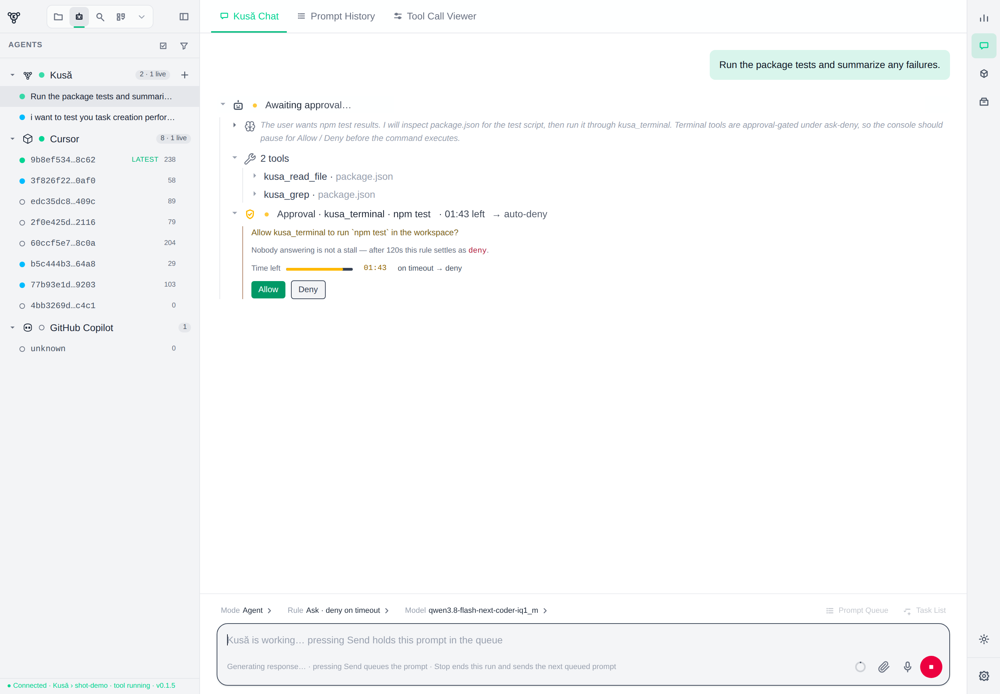
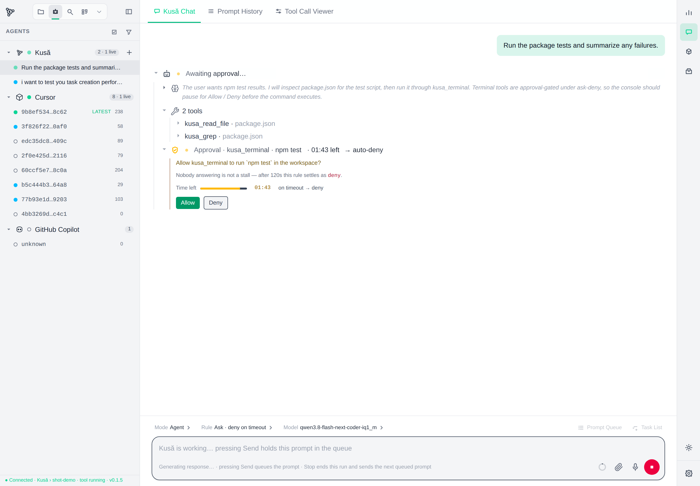
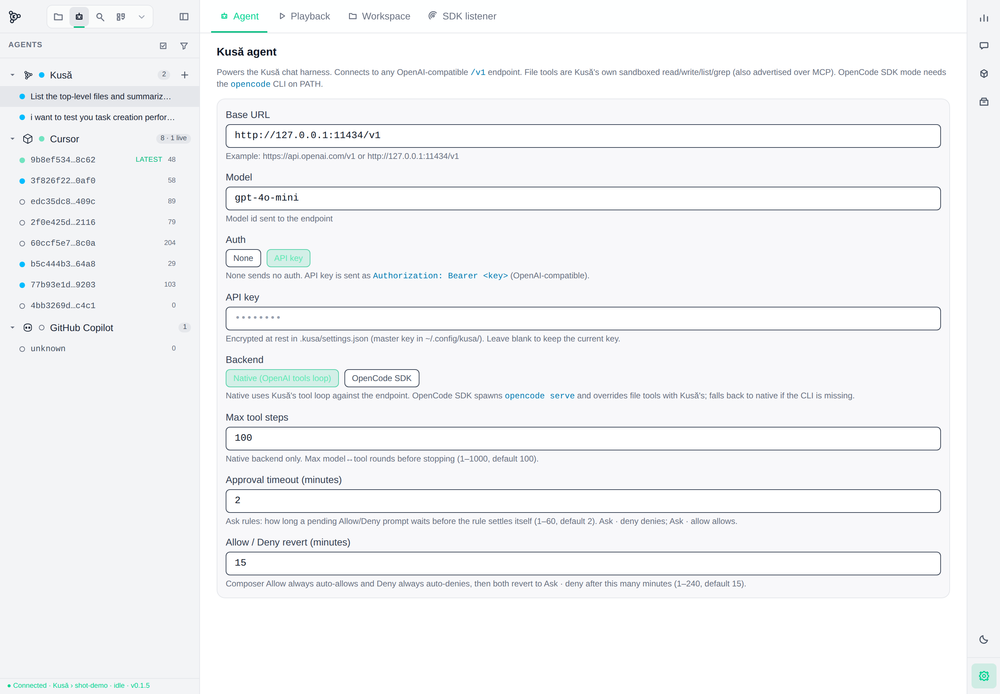
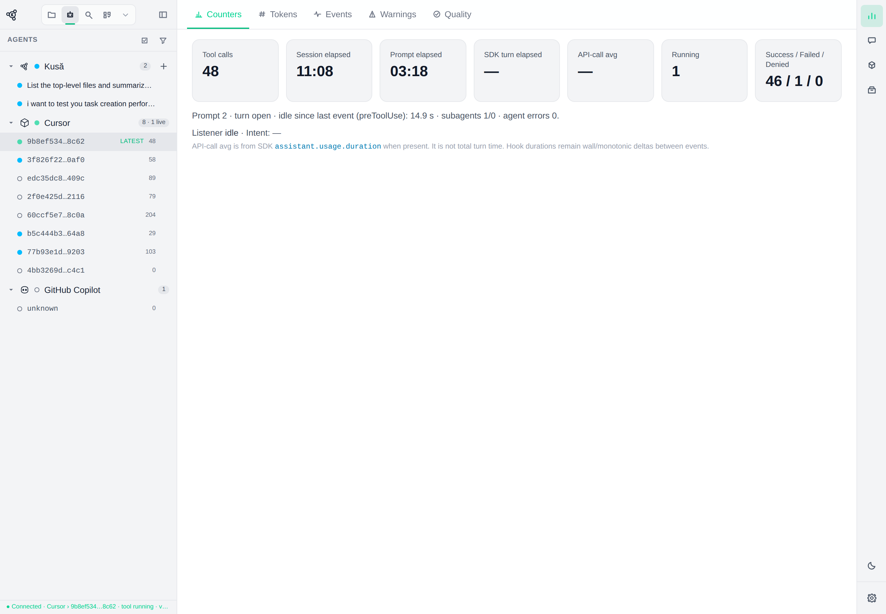
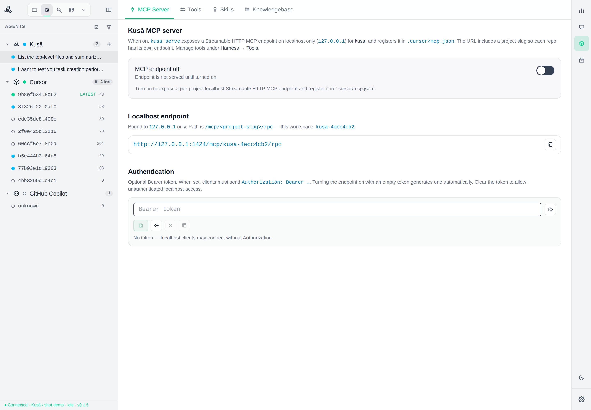
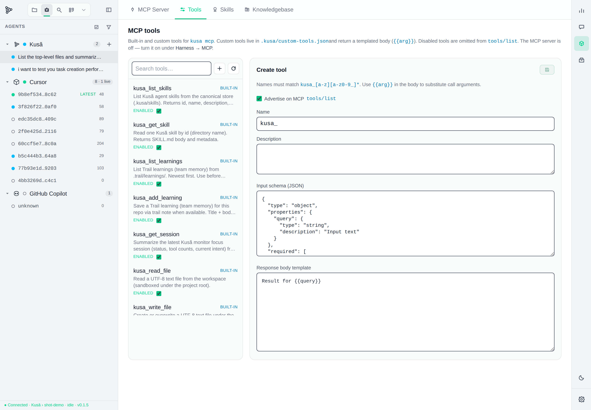
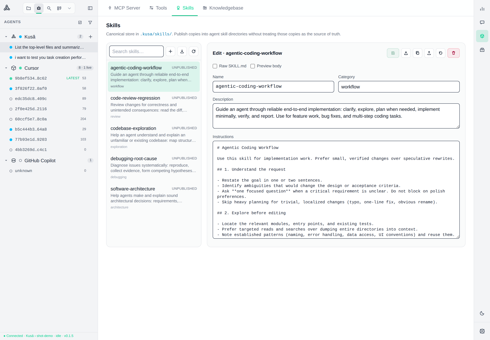
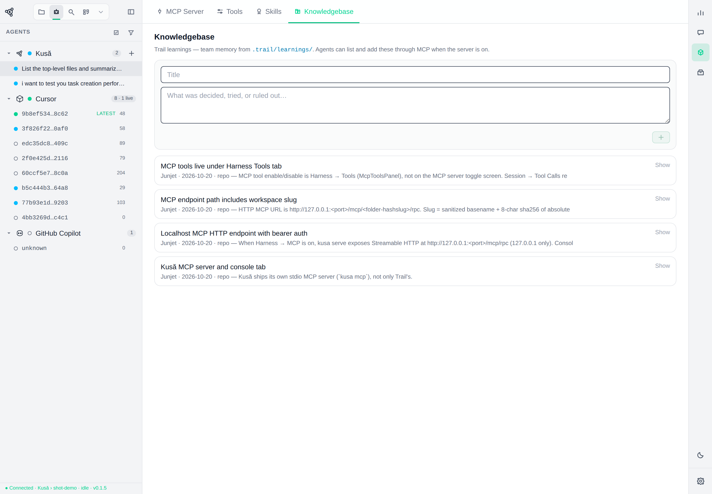
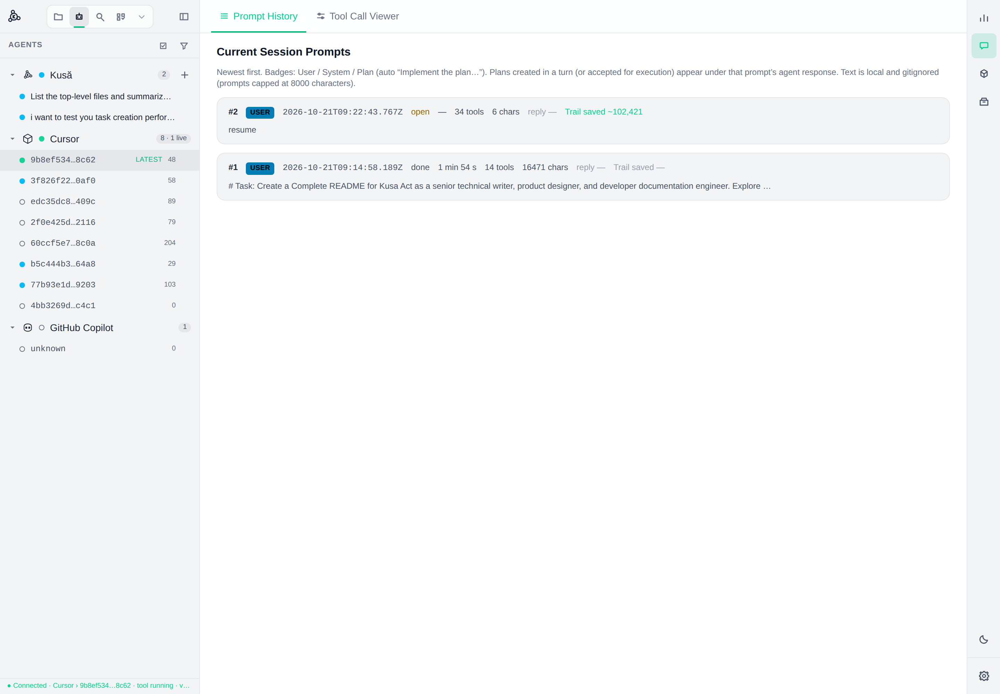
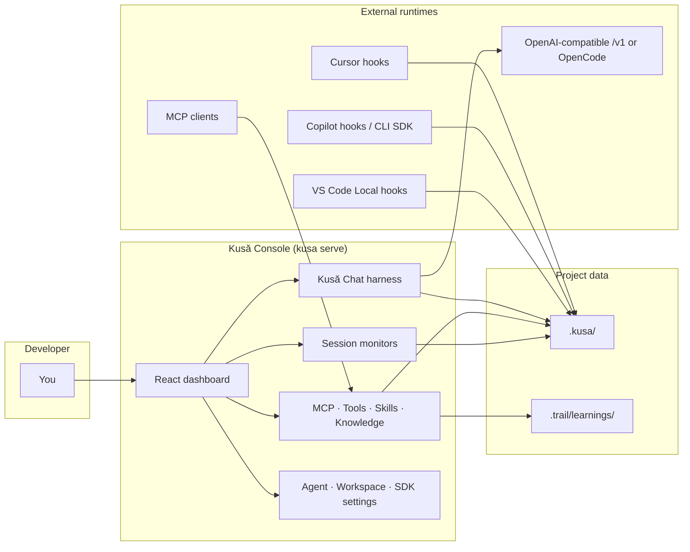

# Kusă

<p align="center">
  
</p>

<p align="center">
  <strong>Your AI coding workflow. Your tools. Your rules.</strong>
</p>

<p align="center">
  One workflow · Multiple agents · Shared knowledge · Better guardrails · Full visibility
</p>

<p align="center">
  <a href="LICENSE"></a>
  <a href="package.json">= 22.5" /></a>
  <a href="package.json"></a>
</p>

**Kusă** is a customizable, extensible, and observable **harness for agentic software development**. It sits between you and the agents you already use — Cursor, GitHub Copilot, VS Code Local, local models, frontier models, MCP servers, and reusable skills — and gives you one console for chat, tools, conventions, project knowledge, and execution visibility.

It is not “another chatbot,” a full IDE replacement, or only an MCP client. It is the workflow layer those pieces were missing.

**Portable by design:** install it per repository on a laptop or a remote dev server, open the console as a local web portal (`kusa serve`), and — when you need access from another machine — forward that same localhost portal through Tailscale or a Cloudflare Tunnel. No separate “cloud product” is required; the harness stays with the repo.

<p align="center">
  
</p>

---

## Contents

- [Why Kusă exists](#why-kusă-exists)
- [Problems and solutions](#problems-and-solutions)
- [Features](#features)
- [Architecture](#architecture)
- [Quickstart](#quickstart)
- [Portability and remote access](#portability-and-remote-access)
- [Visual walkthrough](#visual-walkthrough)
- [Configuration](#configuration)
- [CLI reference](#cli-reference)
- [Roadmap](#roadmap)
- [Development](#development)
- [Safety and privacy](#safety-and-privacy)
- [Contributing, license, support](#contributing-license-support)

---

## Why Kusă exists

I built Kusă because agentic development kept fracturing under its own power.

The ecosystem already offers strong coding agents, local models, frontier models, IDE assistants, CLI agents, MCP servers, and reusable skills. What it does not offer is a single place to *own* the workflow when you move between them.

Conversations and discoveries stayed trapped in one agent’s session. Team conventions had to be re-explained per tool. IDE-integrated agents rarely exposed enough surface to add custom tools or guardrails. When an agent looped on the same tool call, I usually saw the final apology — not the execution trail that would have explained it. Combining a local model for cheap exploration with a frontier model for hard edits meant maintaining entirely separate habits.

Kusă is the practical response to that mess: one localhost console, one gitignored project data folder (`.kusa/`), hooks into the agents you already run, a first-party chat harness when you want to drive the work yourself, and clear visibility when something goes sideways.

---

## Problems and solutions

| Problem | What Kusă does today |
| --- | --- |
| **Fragmented workflows** across Cursor, Copilot, Local, and custom agents | Hook adapters write the same `.kusa/` layout; the console shows harnesses side by side. First-party **Kusă Chat** is available when you want an in-console agent. |
| **Lost context and knowledge** across sessions | **Harness → Knowledgebase** browses and adds Trail learnings (`.trail/learnings/`). MCP can list/add the same notes when the server is on. |
| **Inconsistent team conventions** | Canonical **skills** live in `.kusa/skills/` and can be published into agent skill directories. Starter skills ship for common coding workflows. |
| **Limited customization** | OpenAI-compatible agent endpoint (local or remote), native tool loop or **OpenCode SDK**, custom MCP tools (`.kusa/custom-tools.json`), and per-project MCP HTTP endpoint. |
| **Weak guardrails** | Composer **Ask / Plan / Agent** modes, approval rules for terminal/browser tools, Trail/Git detect + enforce settings, sandboxed file tools. |
| **Poor observability** | Live counters, events, warnings, tool-call statistics, prompt history, plans/todos, optional Copilot CLI SDK listener. |
| **Model / agent fragmentation** | One console for hooked IDE agents **and** the Kusă harness pointed at any `/v1` endpoint (Ollama, OpenAI, gateway, etc.). |
| **Locked to one laptop** | Per-repo install on a local machine or remote **dev server**; localhost web portal via `kusa serve`; optional **Tailscale** / **Cloudflare Tunnel** for remote browsers (see [Portability](#portability-and-remote-access)). |

*Planned / partial items are called out in [Roadmap](#roadmap) — not sold as finished product. Sidebar Explorer / Search / Extensions icons currently show placeholder “coming soon” panes.*

---

## Features

### Chat harness

The console includes a first-party **Kusă Chat** session (`Chat Session → Kusă Chat`).

- Drive an OpenAI-compatible model against the workspace with Kusă tools: sandboxed files (`kusa_read_file`, `kusa_write_file`, `kusa_patch_file`, `kusa_delete_file`, `kusa_list_dir`, `kusa_grep`), approval-gated `kusa_terminal` / `kusa_browse`, task tools (`kusa_task_add` / list / update), Trail helpers, and `kusa_ask`.
- Composer controls: **Ask** (read-only), **Plan** (read-only numbered plan), **Agent** (read/write; commands follow approval rules).
- Approval rules for gated tools: ask-deny / ask-allow / allow / deny, with configurable timeout and allow/deny auto-revert windows.
- Queue prompts while a turn is busy; task list above the composer; stop in-flight turns; interactive asks when the agent needs a decision.
- Thinking + tool rows stream into the transcript so execution is visible, not hidden behind a final paragraph.

<p align="center">
  
</p>

### Model and agent configuration

**Settings → Agent** configures the harness:

| Setting | Behavior |
| --- | --- |
| Base URL | Any OpenAI-compatible `/v1` endpoint (cloud or local) |
| Model | Model id sent to the endpoint |
| Auth | None, or API key (`Authorization: Bearer …`) |
| Backend | **Native** OpenAI tools loop, or **OpenCode SDK** (requires `opencode` on `PATH`) |
| Max tool steps | Caps iterative tool loops |
| Approval timeouts | How long gated tools wait; how long Allow/Deny stick |

API keys are **encrypted at rest** in `.kusa/settings.json` (AES-256-GCM). The master key lives outside the workspace at `~/.config/kusa/master.key` (mode `600`, auto-created), or via `KUSA_SECRETS_KEY`. The browser only ever sees `agentApiKeySet`.

<p align="center">
  
</p>

### Multi-agent session monitoring

Hooks (and, for Copilot CLI, an optional SDK listener) record what external agents do without blocking them:

- **Cursor**, **GitHub Copilot** (VS Code Chat + CLI), and **VS Code Local** adapters today
- Per-harness session lanes in one sidebar
- Counters, token usage (when the harness provides it), events, warnings (slow / repeated calls), data-quality notes
- Tool Call Viewer with per-tool totals and child rows (terminal program names, relative file paths)
- Prompt history with plan/todo snapshots when detectable

<p align="center">
  
</p>

### MCP server and tools

**Harness → MCP Server** can expose a **localhost-only** Streamable HTTP MCP endpoint for this project:

`http://127.0.0.1:<port>/mcp/<project-slug>/rpc`

Optional Bearer auth; registration into `.cursor/mcp.json` when enabled. Built-in and custom tools are managed under **Harness → Tools** (custom tools in `.kusa/custom-tools.json`). Disabled tools are omitted from `tools/list`.

Built-in tools include skills, learnings, session summary, and sandboxed file helpers (same family the chat harness uses).

<p align="center">
  
</p>

<p align="center">
  
</p>

`kusa mcp` remains available as a **stdio** fallback; prefer the HTTP endpoint from the console when you are already running `kusa serve`.

### Skills

**Harness → Skills** edits the canonical store under `.kusa/skills/`.

- Create / edit / validate / preview `SKILL.md`
- Import and duplicate
- Publish copies into detected agent skill directories without treating those copies as the source of truth
- Starter skills (workflow, review, exploration, debugging, architecture) seed a new store

<p align="center">
  
</p>

### Knowledge and learnings

**Harness → Knowledgebase** lists Trail learnings from `.trail/learnings/` and lets you add notes from the console. Agents can list and add the same memory through MCP when the server is enabled. This is team-oriented project memory — not a hidden chat transcript dump.

<p align="center">
  
</p>

### Workflow: prompts, plans, and tasks

- **Chat Session → Prompt History** shows prompts, replies (when the harness provides them), and plan/todo snapshots.
- Kusă Chat can maintain a **task list** via task tools; the composer exposes queue + tasks above the input.
- Hooked agents contribute plan/todo data when their tools or transcripts expose it (for example `TodoWrite` / plan files).

<p align="center">
  
</p>

### Workspace guardrails (Git & Trail)

**Developer Tools → Git / Trail** (and Settings → Workspace) detect whether the folder is a git repo and whether Trail is installed/initialized. Enforcement can badge the console when something required is missing. The Kusă agent can also call Trail (`kusa_trail_ask` / `kusa_trail_map`) and optionally require Trail consultation before writes when enforce is on.

### What Kusă owns vs what agents own

| Kusă-owned | Supplied by external agents / models / MCP |
| --- | --- |
| Console UI, `.kusa/` state, hooks pipeline | Model weights and vendor agent UIs |
| Kusă Chat loop, file/terminal/browser tool gates | Cursor / Copilot / Local tool runtimes |
| MCP HTTP endpoint + custom tool templates | Third-party MCP servers you attach elsewhere |
| Skills canonical store + publish | Destination agent skill loaders |
| Learnings UI over `.trail/learnings/` | Trail CLI / graph (`@trailhq/trail-code`) |

---

## Architecture



Runtime data for the consumer project lands in **`.kusa/`** (override with `KUSA_DIR`). Workspace root for Git/Trail detection is `process.cwd()` or `KUSA_WORKSPACE`.

---

## Quickstart

### Prerequisites

- **Node.js ≥ 22.5** (see `engines` in `package.json`)
- A project where you want monitoring and/or Kusă Chat
- Optional: Cursor and/or GitHub Copilot installed if you want IDE hook adapters
- Optional: `opencode` on `PATH` for the OpenCode SDK backend
- Optional: [`@trailhq/trail-code`](https://www.npmjs.com/package/@trailhq/trail-code) for Trail tabs and Trail-aware agent tools

Supported platforms: anything that runs modern Node (developed on Linux/WSL and macOS-friendly; Windows works via Node + the PowerShell Copilot hook templates `kusa init` installs).

### Install

From this repository (recommended while the package is developed in-tree):

```bash
git clone https://github.com/junjettrasmonte/kusa.git
cd kusa
npm install
npm link                 # registers the `kusa` binary globally from this working copy
```

`package.json` declares publish metadata for npm (`name: kusa`), but a public `npm install --global kusa` registry package was **not** verified at documentation time. Prefer `npm link` from a clone until you confirm the package on [npmjs.com/package/kusa](https://www.npmjs.com/package/kusa).

Remove the link with `npm unlink --global kusa`.

### Wire a project

```bash
cd your-project
kusa init          # detects Cursor / Copilot markers; writes hooks; adds npm scripts
kusa serve         # http://127.0.0.1:1424/dashboard.html
```

Force a harness: `kusa init --cursor` or `kusa init --copilot`. A repo with neither marker gets both hook sets.

### Configure the Kusă agent

1. Open the console → **Settings → Agent**.
2. Set **Base URL** (for example `http://127.0.0.1:11434/v1` for a local OpenAI-compatible server, or a cloud `/v1` URL).
3. Set **Model**, choose **Auth** (None or API key), and **Backend** (Native or OpenCode SDK).
4. Open **Chat Session → Kusă Chat**, create/select a Kusă session, and send a task.

### Enable MCP (optional)

1. **Harness → MCP Server** → turn the endpoint on.
2. Copy the localhost URL (includes a per-project slug).
3. Manage advertised tools under **Harness → Tools**.
4. Point an MCP client at that URL (Cursor registration is written to `.cursor/mcp.json` when enabled).

### First hooked-agent check

1. Keep `kusa serve` running.
2. Start a **new** Cursor or Copilot chat in the project (existing conversations may not load hooks added mid-session).
3. Ask the agent to use a tool.
4. Confirm a session appears under that harness in the sidebar and counters move.

Until a session file appears under `.kusa/<harness>/`, treat that harness as unwired (`liveSessionVerified` stays false).

### Common troubleshooting

| Symptom | What to check |
| --- | --- |
| `kusa: command not found` | Run `npm link` from a clone so the binary is on your global npm bin `PATH` |
| Console opens but no Cursor/Copilot rows | Hooks installed? New chat started after `kusa init`? |
| Kusă Chat errors on send | Base URL reachable? Model id valid? Auth mode matches the endpoint? |
| MCP clients cannot connect | Endpoint toggled on? Correct slug URL? Bearer token if configured? |
| Delete / live Git·Trail refresh unavailable | Open via `kusa serve` (file:// HTML is view-only) |
| Theme wrong in docs screenshots | Console theme toggle → Light (`localStorage` key `monitor.theme`) |

---

## Portability and remote access

Kusă is a **per-repo Node process**, not a hosted SaaS console. The same CLI works on:

| Where you run it | What you get |
| --- | --- |
| **Local machine** (laptop / workstation) | `kusa serve` → `http://127.0.0.1:1424/dashboard.html` next to your IDE |
| **Dev server / remote VM** (SSH box, cloud workspace) | Same console for that checkout’s `.kusa/` data and workspace tools |
| **Any machine with Node ≥ 22.5** | Link or install the CLI, `kusa init` in the project, `kusa serve` |

Data stays in the consumer project’s **`.kusa/`** folder (override with `KUSA_DIR`). Point `kusa serve` at a different checkout and you get that project’s sessions, settings, skills, and MCP state.

`kusa serve` **binds `127.0.0.1` only** (by design). That keeps the portal off the public LAN by default. To use it as a **web portal from another device**, keep `kusa serve` on localhost and put a private tunnel in front of it — Tailscale (tailnet) or Cloudflare Tunnel (hostname you control).

> **Security:** tunneling exposes the full console (chat, settings, MCP controls, workspace tools) to whoever can reach the URL. Prefer Tailscale (private tailnet) for team access. If you use a public Cloudflare hostname, restrict access (Cloudflare Access, Zero Trust, etc.) and treat agent API keys / MCP bearer tokens as exposed to that surface. Do not put an unauthenticated tunnel on the open internet.

### Option A — Tailscale (private web portal)

Best when you and your teammates already share a Tailscale tailnet. The console stays off the public internet.

1. On the machine that has the repo (laptop or dev server), start Kusă as usual:

   ```bash
   cd /path/to/your-project
   kusa serve
   # → http://127.0.0.1:1424/dashboard.html
   ```

   Use another port if needed: `kusa serve --port 1424` or `KUSA_PORT=1424`.

2. Install and log in to [Tailscale](https://tailscale.com/download) on that machine. Enable **MagicDNS** and **HTTPS certificates** for the tailnet (required for Serve; new tailnets usually have these on).

3. From the same machine, proxy the localhost portal into your tailnet:

   ```bash
   tailscale serve 1424
   ```

   Equivalent forms: `tailscale serve localhost:1424` or `tailscale serve http://127.0.0.1:1424`.

4. Copy the HTTPS URL from the CLI output (shape: `https://<device>.<tailnet>.ts.net`). Open it in a browser on any device signed into the same tailnet — append `/dashboard.html` if you land on `/` and need the console explicitly:

   ```text
   https://<device>.<tailnet>.ts.net/dashboard.html
   ```

5. Optional: keep Serve running after you close the terminal:

   ```bash
   tailscale serve --bg 1424
   ```

6. When finished:

   ```bash
   tailscale serve reset
   # or: Ctrl+C if you used a foreground `tailscale serve`
   ```

**Notes**

- Tailscale Serve talks to `http://127.0.0.1:1424` — matching how Kusă listens. You do not need to rebind Kusă to `0.0.0.0`.
- For a public URL outside the tailnet, Tailscale offers **Funnel** (`tailscale funnel 1424`). That is internet-reachable; only use it with strong access controls.

### Option B — Cloudflare Tunnel

Best when you want a stable hostname (for example `kusa.example.com`) without opening inbound firewall ports on the host.

#### Quick try (temporary `*.trycloudflare.com` URL)

1. Start Kusă on the machine that has the repo:

   ```bash
   cd /path/to/your-project
   kusa serve
   ```

2. Install [`cloudflared`](https://developers.cloudflare.com/cloudflare-one/connections/connect-apps/install-and-setup/installation/), then:

   ```bash
   cloudflared tunnel --url http://127.0.0.1:1424
   ```

3. Open the printed `https://….trycloudflare.com` URL and go to `/dashboard.html`.

This URL is public for as long as the process runs. Treat it as temporary and unauthenticated unless you add Cloudflare Access in front.

#### Named tunnel (stable hostname)

1. Authenticate and create a tunnel (once per account / host setup):

   ```bash
   cloudflared tunnel login
   cloudflared tunnel create kusa-console
   ```

2. Route a DNS name you control to that tunnel (replace with your zone and hostname):

   ```bash
   cloudflared tunnel route dns kusa-console kusa.example.com
   ```

3. Point the tunnel at Kusă’s localhost listener. Example config (`~/.cloudflared/config.yml` — paths and tunnel id from `cloudflared tunnel list`):

   ```yaml
   tunnel: <TUNNEL_UUID>
   credentials-file: /home/<you>/.cloudflared/<TUNNEL_UUID>.json

   ingress:
     - hostname: kusa.example.com
       service: http://127.0.0.1:1424
     - service: http_status:404
   ```

4. On the host, run Kusă and the tunnel together:

   ```bash
   cd /path/to/your-project
   kusa serve
   # other terminal:
   cloudflared tunnel run kusa-console
   ```

5. Browse to `https://kusa.example.com/dashboard.html`.

6. **Recommended:** put [Cloudflare Access](https://developers.cloudflare.com/cloudflare-one/policies/access/) (or another identity gate) on that hostname so the console is not open to the world.

### Dev-server checklist

Typical pattern for a remote coding box:

```bash
# on the dev server, inside the repo
git clone <your-project> && cd <your-project>
# install / link kusa once on that machine
kusa init
kusa serve --port 1424

# then either:
tailscale serve 1424
# or:
cloudflared tunnel --url http://127.0.0.1:1424
```

Hooks and agents still run in whatever environment edits that checkout (SSH session, Cursor Remote, etc.). The tunnel only carries the **console UI and APIs**; it does not replace the IDE.

---

## Visual walkthrough

All screenshots below are **light mode**, captured from a live `kusa serve` session with the script in [`scripts/capture-screenshots.mjs`](scripts/capture-screenshots.mjs).

| Screen | What you are looking at |
| --- | --- |
| [Overview](docs/screenshots/kusa-overview.png) | Kusă Chat with thinking, tools, and approval gate |
| [Chat harness](docs/screenshots/chat-harness.png) | Expanded thought, tool calls, Allow/Deny gate |
| [Prompt / workflow](docs/screenshots/workflow-management.png) | Prompt History for a live hooked session |
| [Execution monitor](docs/screenshots/execution-monitor.png) | Monitors → Counters |
| [Tool Call Viewer](docs/screenshots/tool-call-viewer.png) | Per-tool statistics for a session |
| [Events](docs/screenshots/events-timeline.png) | Monitors → Events timeline |
| [MCP server](docs/screenshots/mcp-server.png) | Localhost MCP endpoint controls |
| [MCP tools](docs/screenshots/mcp-tools.png) | Built-in / custom tool management |
| [Skills](docs/screenshots/skills-editor.png) | Canonical skills editor |
| [Knowledge](docs/screenshots/knowledge-learnings.png) | Trail learnings knowledgebase |
| [Model config](docs/screenshots/model-configuration.png) | Settings → Agent |

Regenerate (with the console already running, Chrome available, and `puppeteer-core` installed):

```bash
kusa serve   # in another terminal
node scripts/capture-screenshots.mjs
```

`puppeteer-core` is **not** a runtime dependency of Kusă; install it only when you need screenshots.

---

## Configuration

### Environment variables

Prefer `KUSA_*` (legacy `COPILOT_MONITOR_*` still accepted where noted in code):

| Variable | Purpose |
| --- | --- |
| `KUSA_DIR` | Override data folder (default `<cwd>/.kusa`) |
| `KUSA_WORKSPACE` | Override workspace root for Git/Trail |
| `KUSA_PORT` | Default port for `kusa serve` when `--port` omitted (default `1424`) |
| `KUSA_SECRETS_KEY` | Master key for settings encryption (32-byte base64 or 64-char hex) |
| `KUSA_OPEN` | `browser` / `none` — control session-open launcher |
| `KUSA_TOOL_WARN_MS` | Slow tool warning threshold |
| `KUSA_REPEAT_WINDOW_MS` / `KUSA_REPEAT_COUNT` | Repeated-call warning window |
| `KUSA_PROMPT_TOOL_WARN` / `KUSA_PROMPT_WARN_MS` / `KUSA_SESSION_WARN_MS` | Prompt/session warnings |
| `KUSA_MAX_EVENTS` | Cap event history (default 400) |

Threshold defaults can also be copied from `src/thresholds.json` → `.kusa/thresholds.json`.

### Important files under `.kusa/`

| Path | Purpose |
| --- | --- |
| `index.json` | Shared monitor state, current sessions, in-flight calls |
| `<harness>/<session>.json` | Per-session counters and tool rows |
| `<harness>/<session>.events.jsonl` | Recent event metadata |
| `settings.json` | Agent + workspace settings (secrets encrypted; mode `600`) |
| `mcp.json` | MCP server enablement / auth state |
| `custom-tools.json` | Custom MCP tool definitions |
| `skills/` | Canonical skills store |
| `monitor-data.js` / `dashboard.*` | Console bootstrap artifacts |
| `dashboard.md` | Markdown snapshot for in-editor preview |

### Hook adapters (summary)

| Harness | Config written by `kusa init` | Notes |
| --- | --- | --- |
| Cursor | `.cursor/hooks.json` + `.cursor/hooks/kusa.cjs` | Start a **new** chat after install |
| Copilot (VS Code) | `.github/hooks/copilot-runtime-monitor.json` | Session Target = Copilot |
| Copilot CLI | `.github/extensions/kusa-session-listener/` | SDK `joinSession()` when `SESSION_ID` present |
| VS Code Local | Same Copilot hooks file; payloads mapped to `vscode-local` | No failure/session-end events — incomplete calls marked on stop |

Hooks print `{}` and do not allow, deny, or follow up. Monitoring must never block a tool call if Node is missing.

---

## CLI reference

```text
kusa serve [--port <n>]   Start dashboard (default http://127.0.0.1:1424/dashboard.html)
kusa init [dir]           Detect Cursor / Copilot, write hooks, add npm scripts
kusa hook <event>         Harness hook entry (stdin JSON)
kusa open                 Open Markdown preview / browser once per session
kusa demo                 Synthetic events → temp directory
kusa build                Rebuild React dashboard assets
kusa mcp                  Stdio MCP server (skills, learnings, session)
kusa test                 Run package tests
kusa version              Show installed version
kusa help                 Show help
```

Package scripts (from this repo): `npm test`, `npm run serve`, `npm run build`, `npm run dev` (Vite HMR on `:1237`, proxying data from serve on `:1424`), `npm run demo`.

---

## Roadmap

Derived from the current codebase and [`CHECKLIST.md`](CHECKLIST.md) — not a marketing backlog.

### Implemented

- Multi-harness hooks + live React console
- Kusă Chat (native loop + OpenCode SDK backend)
- Ask / Plan / Agent modes and approval gates
- MCP HTTP endpoint, built-in + custom tools, skills store, learnings UI
- Encrypted agent API key storage
- Copilot CLI SDK session listener (confirmed for CLI only)
- Git / Trail readiness panels and settings

### Partial / runtime-dependent

- SDK listener for **VS Code Copilot Chat**, **Local**, and **Cursor** — no public `joinSession()` API; hooks-only
- Token / reasoning detail richness varies by harness and model
- Plan/todo extraction depends on agent tools and transcript layout
- Sidebar Explorer / Search / Extensions views are present in the shell; treat non-Agents views as evolving UI, not a complete IDE file tree product

### Planned improvements

- Broader harness adapters beyond Cursor / Copilot / Local
- Richer cross-agent shared memory beyond Trail learnings + skills publish
- Deeper loop detection UX (warnings exist; automatic intervention does not)
- Hardening custom-tool authoring and skill distribution for teams

---

## Development

```bash
git clone https://github.com/junjettrasmonte/kusa.git
cd kusa
npm install
npm test
npm run build          # regenerates src/dashboard.{html,js,css}
npm run serve          # or: kusa serve after npm link
```

UI source lives under `src/ui/` (Vite + React + Tailwind). Hook/monitor/agent logic is plain Node under `src/`. After UI edits, run `npm run build` and commit the regenerated dashboard bundle.

---

## Safety and privacy

- Hook failures catch and still return `{}` so monitoring cannot deny tools by accident.
- Tool **arguments and results are not persisted** from hooks (with narrow, intentional exceptions: terminal program name + full command for display; relative file paths for file tools).
- Agent API keys never leave the Node process in plaintext; `GET /settings` and `monitor-data.js` expose only `agentApiKeySet`.
- MCP HTTP and `kusa serve` bind to **127.0.0.1** only; optional Bearer token recommended if you enable the MCP endpoint. Remote access should go through a private tunnel (Tailscale) or an identity-gated Cloudflare hostname — see [Portability and remote access](#portability-and-remote-access).
- Event history and child maps are capped; state updates use locking and atomic renames.

---

## Contributing, license, support

- **Issues:** [github.com/junjettrasmonte/kusa/issues](https://github.com/junjettrasmonte/kusa/issues)
- **License:** [MIT](LICENSE)
- **Author:** Junjet Trasmonte

There is no separate `CONTRIBUTING.md` or `SECURITY.md` in this repository yet. For vulnerabilities, open a private report via GitHub Security Advisories on the repo if available, or contact the maintainer through the issue tracker without posting secrets.

---

**Kusă** — one workflow for the agents you already use, with the guardrails and visibility you actually need.
